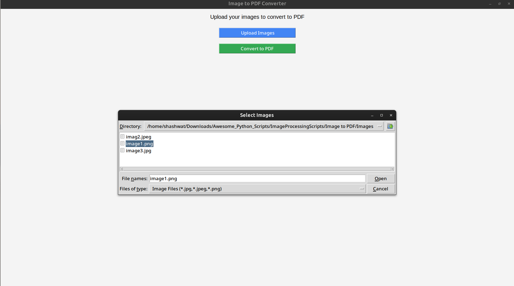
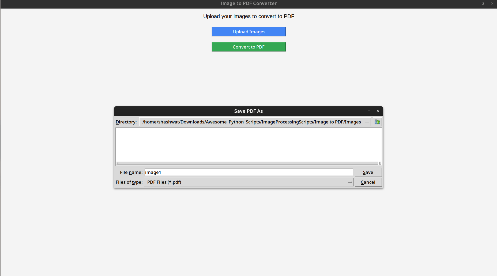
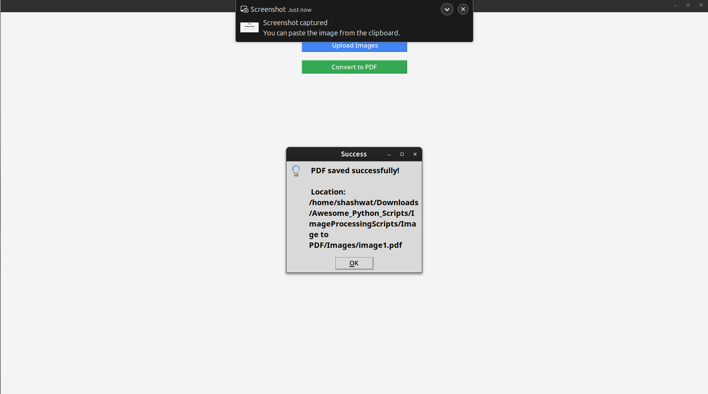

<div align="center">

#  Image to PDF Converter in Python

</div>

##  Example Folder Structure

```
ImageToPDFConverter/
├── Images/
│   ├── image1.png
│   ├── image2.jpeg
│   ├── image3.jpg
│   ├── step1.png
│   ├── step2.png
│   ├── step3.png
│   ├── step4.png
│   ├── step5.png
│   ├── step6.png
│   └── output.pdf
├── README.md
└── image_to_pdf.py
```

##  Aim

The main aim of this project is to provide a simple and user-friendly **GUI interface** that allows users to upload multiple images and convert them into a single **PDF file**.  
It also shows where the file is saved and automatically opens the generated PDF.

---

##  Prerequisites

Make sure you have the following installed:

- **Python 3.x**
- Required Python libraries:
  ```bash
  pip install pillow
  ```

* (Optional) A virtual environment for cleaner setup.

---

## Purpose

The purpose of this project is to simplify the process of combining multiple image files (JPG, JPEG, PNG) into one PDF document using a graphical user interface (GUI) — **no command line required**.

---

## Description

This project uses **Tkinter** for the GUI, **Pillow (PIL)** for image handling, and **webbrowser** to open the created PDF automatically.

### Features

* Upload multiple image files easily.
* Convert all selected images into a single PDF.
* Choose custom file name and save location.
* Automatically open the generated PDF after saving.
* Modern and clean user interface.

---

## Libraries Used

* `tkinter` → for GUI
* `Pillow` → for image processing
* `webbrowser` → to open the created PDF file
* `os` → to handle file paths

---

## Workflow of the Project

### 1. `upload_files()` function

This function opens a file dialog for selecting images (`.jpg`, `.jpeg`, `.png`) and stores them in a list.

### 2. `convert_to_pdf()` function

* Converts all selected images to RGB format.
* Merges them into one PDF file.
* Saves the file to a user-selected location.
* Opens the PDF automatically using the system’s default viewer.

### 3. GUI Layout

* A label that guides the user.
* Two buttons:

  *  **Upload Images**
  *  **Convert to PDF**

---

##  Setup Instructions

1. **Clone the repository or copy the script**

   ```bash
   git clone <your_repo_url>
   ```

   Or simply download the `.py` file.

2. **Navigate to the directory**

   ```bash
   cd ImageToPDFConverter
   ```

3. **Create and activate a virtual environment (recommended)**
   
   For Linux/Mac :
     ```bash
      python -m venv myenv
      source myenv/bin/activate
     ```
   For Windows:
     ```bash
        myenv\Scripts\activate        
     ```

4. **Install dependencies**

   ```bash
   pip install pillow
   ```

5. **Run the program**

   ```bash
   python image_to_pdf.py
   ```

---

##  Example Output

When you run the app:

1. Click **“ Upload Images”** and select your image files.
2. Click **“ Convert to PDF”**.
3. Choose where to save your PDF.
4.  A success message appears and your PDF opens automatically!

---

##  Example

If you upload the image:

```
image1.png
```

The app merges them into a  PDF file like:

```
output.pdf 
```

Then automatically opens it.

---

##  Screenshot (Example)

Example:

```






```

---
## Author
**Shashwat**  

---

##  Conclusion

This project demonstrates how Python’s Tkinter and Pillow can be combined to create a simple yet effective GUI tool.
With minimal dependencies, this app is lightweight, easy to use, and automates the task of combining images into PDFs with a single click.
